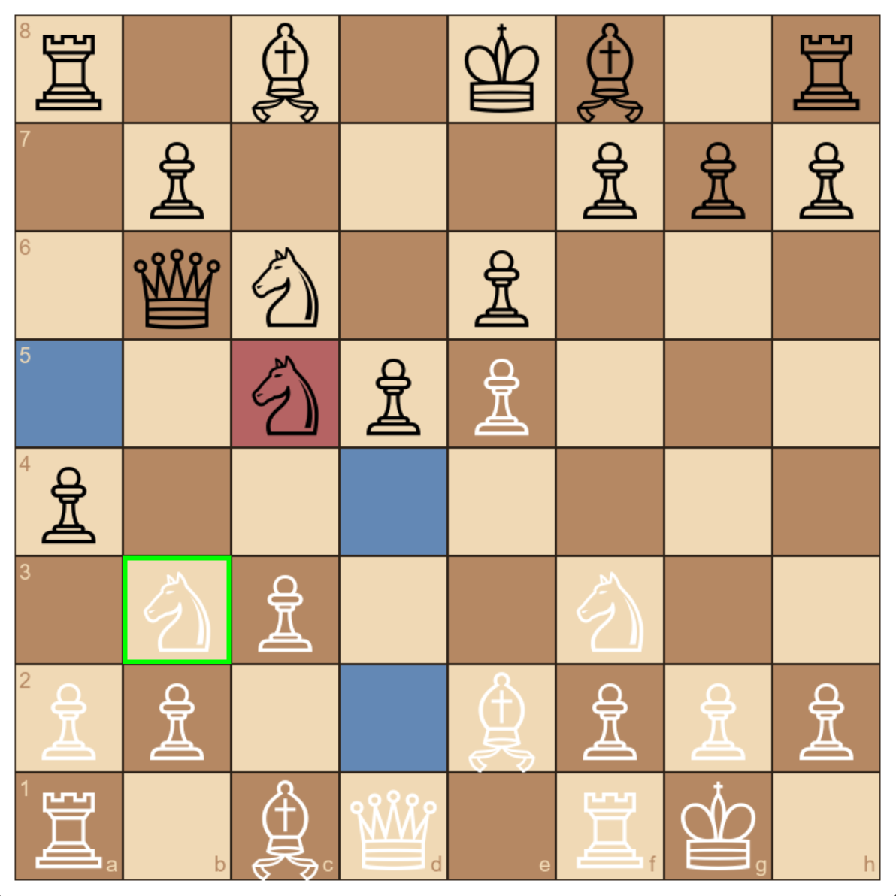
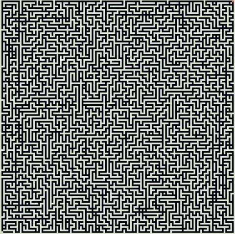
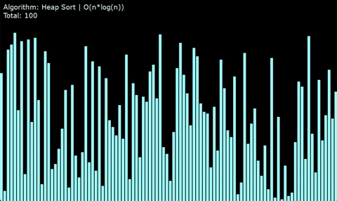
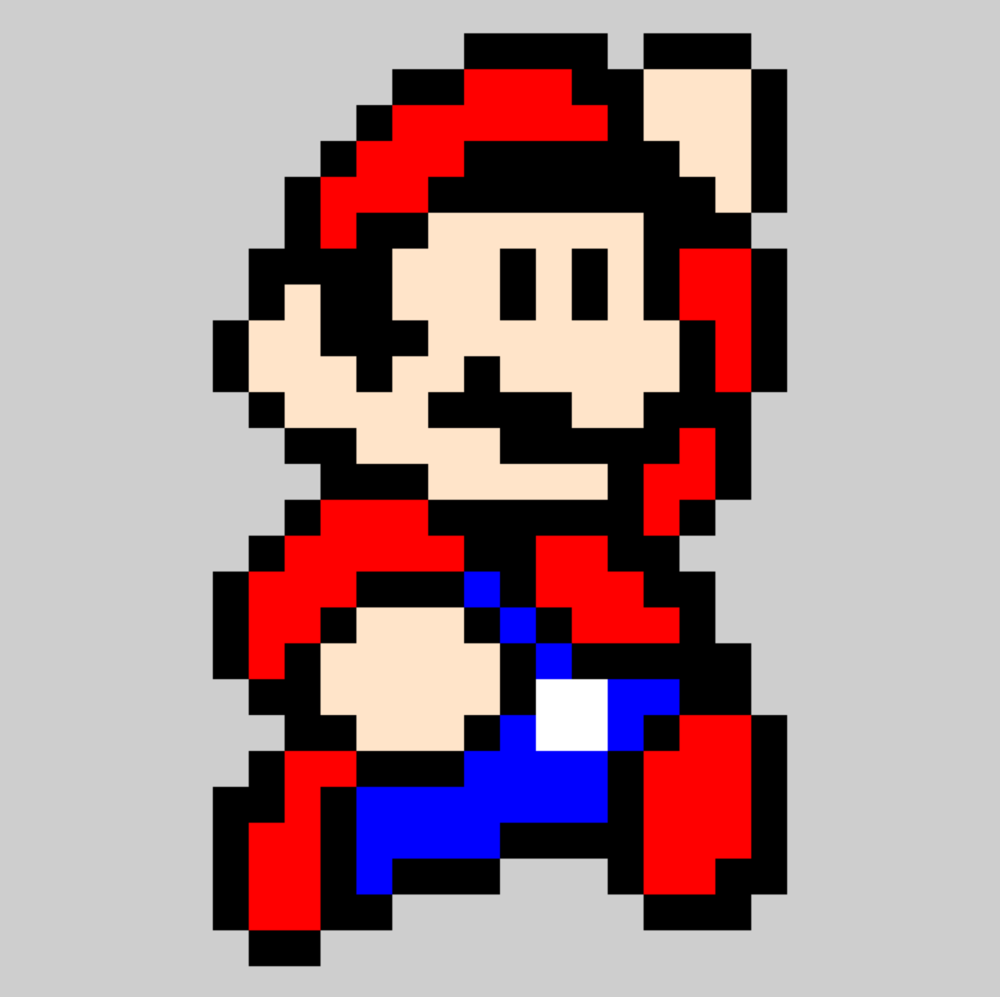
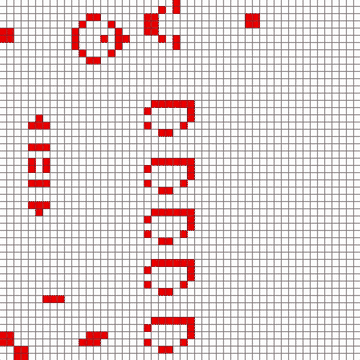
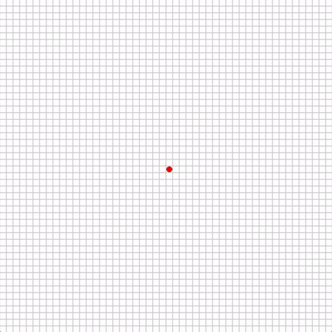
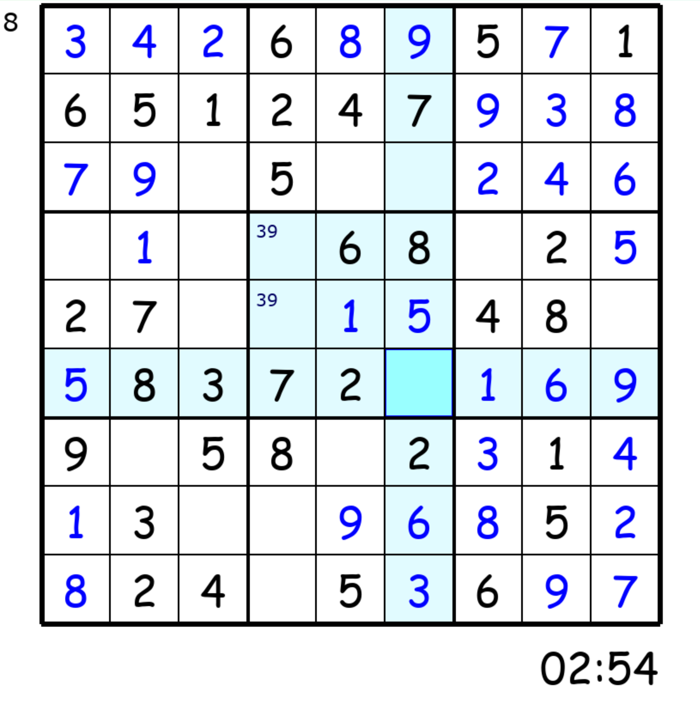
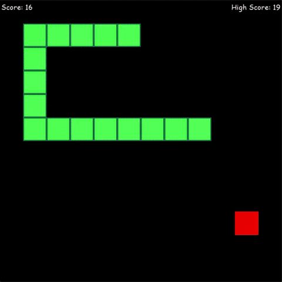
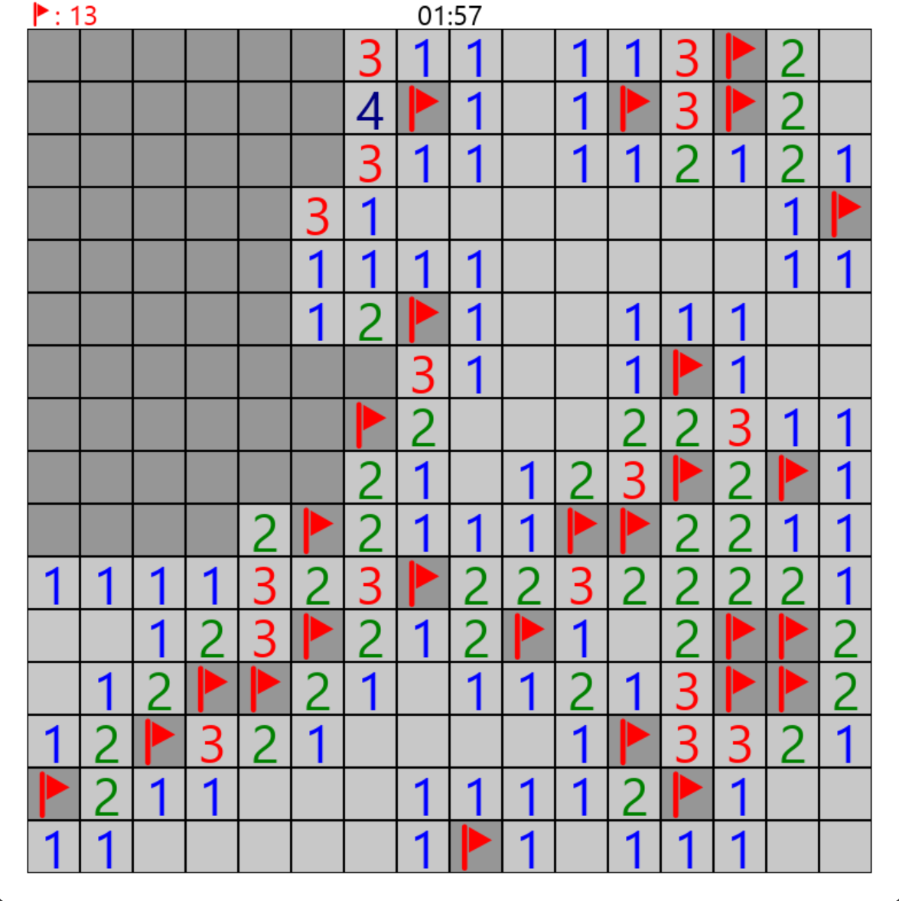

# Pygame Playground

Repository for all of my pygame projects:
- Visualizers: [Pathfinder](#pathfinder), [Sorting Algorithms](#sorting-algorithms), [Paint](#paint)
- Classic Games: [Chess](#chess), [Sudoku](#sudoku), [Minesweeper](#minesweeper), [Snake](#snake)
- Cellular Automata: [Game of Life](#game-of-life), [Langton's Ant](#langtons-ant)

Mostly made for fun or for learning purposes, though a few have potential if developed further.

## Requirements
`pip install pygame requests`

## Chess

Chess implemented from scratch with a custom UI. It can be played against another player locally, or against a bot. Includes various commands and new chess pieces.

**Features**
- Fully functional chess game (checks, en passant, castling, etc.).
- Play against a player locally (Press S for board swapping).
- Play vs a local bot (Easy-Hard), or against an API (Extreme).
- Admin mode: Lock the turn, get hints of best moves, delete or spawn in new pieces, save and load the chessboard, etc.
- Custom chess pieces (spawned with Admin): Star, Nightrider, Archbishop, Empress and Dragon.
- Menu's 'HELP' has a list of all keybinds.

**Future updates**
- Making a custom chess AI with minimax and alpha-beta pruning to play against locally.
- Improving piece readability and adding custom chessboard themes.

## Pathfinder

Visualizer for the A* pathfinding algorithm, which finds the shortest path between two points.

**Features**
- Pathfinder: Pressing SPACE will begin pathfinding. Pressing P will show the algorithm's full process.
- Editing: Edit mazes by drawing on the screen. Can also save, load and clear the grid.
- Two custom mazes (data/maze.txt and data/maze2.txt).
- Custom movement (M + 0-9): Standard, king, horse, diagonals, jumper, flash, wallhugger, drunk, mirror, wormhole.
- Cost calculation (D): Change distance calculation between Manhattan and Euclidean.
- Keybinds are printed at launch.

## Sorting Algorithms

Visualizer for 12 sorting algorithms, from bubble sort to cocktail sort. Has sound.

Keybinds are printed at launch.

(sorting time is slowed down to improve visualization, use 0 to toggle fast sorting)

## Paint

Sketchboard with integrated filters and other features.

**Features**
- 8 default colors, fill tool, opacity and brush size. Can get any color by mixing the standard ones with lower opacity and selecting the result.
- Filters (M + 0-9): Can apply filters to the image, including grayscale, color swap, blur, edge detection and more.
- Can save and load drawings, or even load external images.
- Press H to print all keybinds.

## Game of Life

Implementation of Conway's cellular automata, the [Game of Life](https://playgameoflife.com/). Made a simple default pattern to showcase its potential.

Press H to print all keybinds.

## Langton's Ant

Implementation of [Langton's ant](https://en.wikipedia.org/wiki/Langton%27s_ant), a 2D Turing machine.

Press C to print all keybinds.

## Sudoku

Sudoku implemented with a custom UI and solver, as well as custom patterns.

Keybinds are printed at launch.

## Snake

Simple snake implementation. Includes an Admin mode with various fun commands.

Keybinds are printed at launch.

## Minesweeper

Minesweeper implementation. Includes an Admin mode with custom commands.

Press C to print all keybinds.